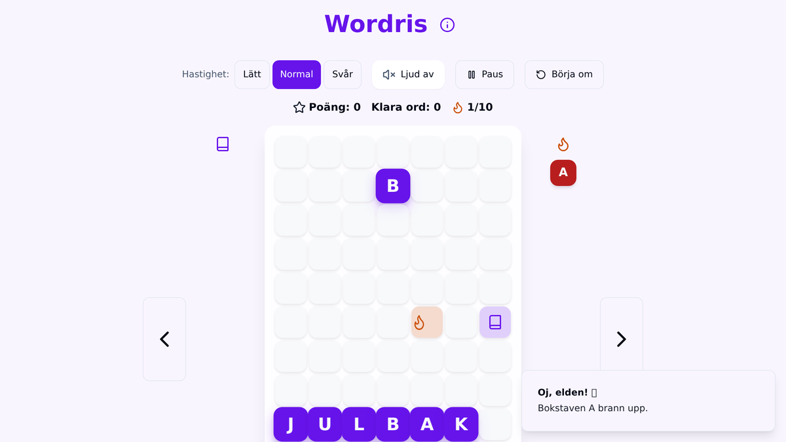

# Wordris

Wordris är ordtetris för nybörjarläsare i låg- och mellanstadiet. Bokstäver faller ner på
spelplanen och barnet styr dem till rätt plats för att bilda ett svenskt ord. Bokstäver kan
sparas i boken, men de som hamnar i elden brinner upp.

**Spela:** https://ordspel.skolappar.com · En del av [Skolappar](https://www.skolappar.com) – pedagogiska appar av föräldrar · öppen källkod (MIT)



Körs fristående.

## Vad du kan göra

- **Bilda ord** av fallande bokstäver på en spelplan med 7 × 12 rutor. Orden är högst sju
  bokstäver och kommer från fem kategorier: kända figurer, städer, djur, mat och julord.
- **Styr** med piltangenterna och håll in mellanslag för att släppa snabbt. På mobil och
  surfplatta finns stora knappar under spelplanen.
- **Boken**: styr en bokstav dit för att spara den. Tryck på en sparad bokstav så läses den upp.
- **Elden**: bokstäver som når elden brinner upp. När tio bokstäver har brunnit är spelet slut.
- **Smart slump**: de flesta nya bokstäver hör till ordet, och brända bokstäver kommer inte
  tillbaka.
- **Tre hastigheter**: lätt, normal och svår.
- **Uppläsning** av händelser med webbläsarens svenska röst. Ljudet går att stänga av.
- Paus, starta om, poäng och antal klarade ord.

## Kom igång

```bash
npm install
npm run dev        # utvecklingsserver
npm run build      # produktionsbygge till dist/
npm run build:dev  # bygge i utvecklingsläge
npm run preview    # förhandsgranska bygget
npm run lint       # eslint
```

Docker-bygget använder Node 22. Spellogiken har tester i `src/models/*.test.ts`. De körs med
`npx vitest run`, eftersom det inte finns något npm-skript för dem.

## Docker

```bash
docker build -t wordris .
docker run --rm -p 8080:8080 wordris
```

Bygget serveras av nginx med `deploy/nginx.conf`.

## Integritet

- Inget konto, ingen inloggning, inga kakor och ingen analys.
- Inga anrop till externa servrar, och ingenting sparas på enheten (ingen `localStorage`).
- Uppläsningen använder webbläsarens inbyggda talsyntes (`speechSynthesis`).
- Typsnittet Fredoka följer med appen (`public/fonts/`).

## Struktur

```
index.html                      startskärm, metadata
src/
  pages/Index.tsx               sidan med spelet
  controllers/useGameController.ts  spelloop, tangentbord, händelser
  models/GameModel.ts           spelregler: fall, bok, eld, ord, bokstavsurval
  models/SoundModel.ts          uppläsning
  constants/gameConstants.ts    planens storlek, hastigheter, max antal brända
  constants/wordBank.ts         ordlistan
  components/GameBoard/         spelplan, hastighet, ljudknapp, touchkontroller
  components/SidePanel/         sparade och brända bokstäver
deploy/nginx.conf               nginx-konfiguration för containern
```

## Licens

MIT – se [LICENSE](LICENSE).
